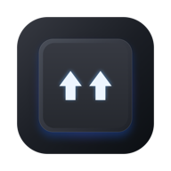

<p align="center">
  
</p>

<h1 align="center">ReShift for Windows</h1>

<p align="center">
  <b>⚡️ Blazing fast, native keyboard layout text converter for Windows written in Rust 🦀</b>
</p>

<p align="center">
  <a href="README.ru.md">🇷🇺 Русская версия</a>
</p>

<p align="center">
  
  
  
  
  
  
</p>

Converts text typed in the wrong layout (`ghbdtn` => `привет`) with a double Shift tap or a customizable hotkey.

## Features

- ⚡️ **Blazing Fast**: Background conversion pipeline — zero UI lag or freezing (< 0.2 ms).
- 🧠 **Smart Conversion**: Converts selected text or wrong-layout line tails without selection (greedy phrase matching or last word).
- 💻 **Console & Terminal Support**: Reconstructs typed commands in Windows Console and Windows Terminal where direct clipboard selection is unavailable.
- 🛡️ **Safe Clipboard**: Preserves all data types (images, files, formatted text) and restores your original clipboard after conversion.
- ⚙️ **Native Win32**: Clean lightweight settings window and system tray integration.
- 🪶 **Ultra Lean**: ~1.2 MB standalone executable, ~3 MB idle memory footprint.

## Building

Requirements: Rust (stable) and Visual Studio Build Tools with C++ workload.

```powershell
# Run unit tests
cargo test --workspace

# Build standalone executable
powershell -ExecutionPolicy Bypass -File scripts\build.ps1
```

The executable is generated in `artifacts\ReShift.exe`.

## Acknowledgments & Inspiration

ReShift is inspired by the ideas, heritage, and pioneers of keyboard layout switching:

- [Punto Switcher](https://yandex.ru/soft/punto/) — the pioneering keyboard layout switcher.
- [Caramba Switcher](https://carambaswitcher.com/) — intelligent, silent background layout switching.
- [langSwitcher](https://github.com/reg2005/langSwitcher) — open-source keyboard layout converter by @reg2005.

> ⚠️ **Note**: ReShift for Windows is under active development (v0.1.0) — features, UI, and shortcuts are actively evolving. Feedback and suggestions are welcome!

## License

[MIT](LICENSE) — Copyright (c) 2026 ReShift Contributors.
