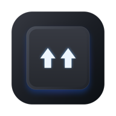

<p align="center">
  
</p>

<h1 align="center">ReShift для Windows</h1>

<p align="center">
  <b>⚡️ Мгновенный, легковесный конвертер раскладки клавиатуры для Windows на Rust 🦀</b>
</p>

<p align="center">
  <a href="README.md">🇬🇧 English version</a>
</p>

<p align="center">
  
  
  
  
  
  
</p>

Исправляет текст, набранный не в той раскладке (`ghbdtn` => `привет`), по двойному нажатию Shift или настраиваемой горячей клавише.

## Возможности

- ⚡️ **Мгновенная работа**: Фоновый конвейер конвертации без малейших задержек (< 0.2 мс).
- 🧠 **Умная конвертация**: Автоматически конвертирует выделенный текст или хвост строки без выделения (жадный поиск фразы или последнее слово).
- 💻 **Поддержка консоли и терминала**: Реконструкция набранного текста в Windows Console и Windows Terminal, где недоступно прямое выделение через буфер обмена.
- 🛡️ **Безопасный буфер обмена**: Сохраняет все типы данных (изображения, файлы, форматирование) и возвращает исходный буфер обмена пользователя.
- ⚙️ **Нативный Win32**: Чистое окно настроек на Win32 и меню в системном трее.
- 🪶 **Компактность**: ~1.2 МБ исполняемый файл, ~3 МБ оперативной памяти в простое.

## Сборка

Требования: Rust (stable) и Visual Studio Build Tools с компонентами C++.

```powershell
# Запуск тестов
cargo test --workspace

# Сборка исполняемого файла
powershell -ExecutionPolicy Bypass -File scripts\build.ps1
```

Исполняемый файл сохраняется в `artifacts\ReShift.exe`.

## Вдохновлено проектами

ReShift вдохновлен идеями и разработками в области автоматического переключения раскладки:

- [Punto Switcher](https://yandex.ru/soft/punto/) — легендарный первопроходец автоматического переключения раскладки.
- [Caramba Switcher](https://carambaswitcher.com/) — умное и тихое фоновое переключение раскладки.
- [langSwitcher](https://github.com/reg2005/langSwitcher) — открытый конвертер раскладки от @reg2005.

> ⚠️ **Примечание**: ReShift для Windows находится в активной разработке (v0.1.0) — функции, интерфейс и настройки могут меняться. Будем рады вашим отзывам и предложениям!

## Лицензия

[MIT](LICENSE) — Copyright (c) 2026 ReShift Contributors.
